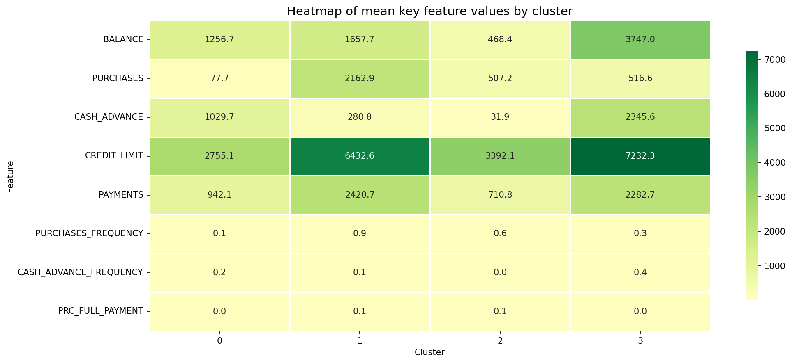
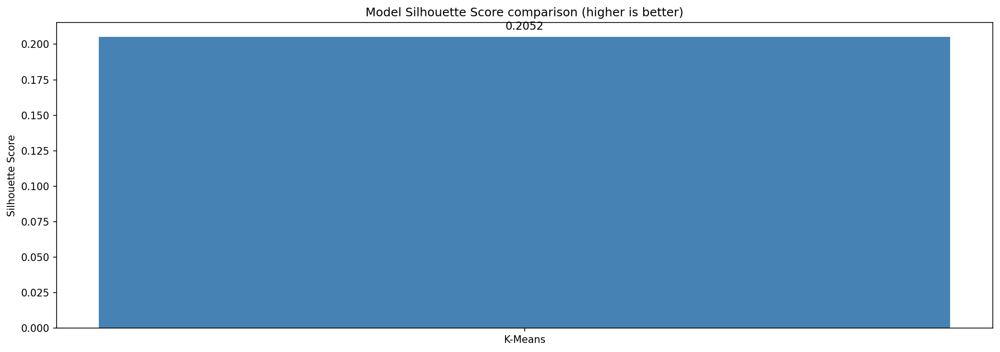

# Credit Card Customer Segmentation

Unsupervised analysis of credit-card customer behavior using preprocessing, feature engineering, PCA and K-Means, with a Streamlit exploration interface.

[Analysis notebook](notebook/credit_card.ipynb) · [Cluster assignments](model/clustering_result.csv) · [Application source](App.py)

## Problem Statement

Treating all cardholders as one population can hide differences in purchasing, balances and cash advances. This project groups similar behavior and profiles the resulting segments to support exploratory customer analysis.

## Methodology

1. Inspect the **CC GENERAL** dataset and missing values.
2. Remove the customer identifier from model features, impute missing numeric values and clip extreme values using IQR boundaries.
3. Create behavioral ratios and standardize the feature space.
4. Apply PCA with a 95% retained-variance target.
5. Compare K-Means settings from 2 to 10 clusters and use the notebook's four-cluster solution.
6. Review cluster metrics, compare feature profiles and export assignments.

The notebook also contains hierarchical-clustering and DBSCAN exploration. The exported segmentation discussed here is the K-Means result.

## Visual Results





These are the repository's existing analysis figures. They are not screenshots of the Streamlit app.

## Insights

The committed output contains **8,950 customers** across four clusters. Counts and means below are calculated from `model/data_with_clusters.csv`.

| Cluster | Customers | Mean balance | Mean purchases | Mean cash advance | Profile suggested by these means |
| --- | ---: | ---: | ---: | ---: | --- |
| 0 | 2,215 | 1,256.72 | 77.68 | 1,029.67 | Low purchase activity |
| 1 | 1,810 | 1,657.72 | 2,162.92 | 280.79 | Purchase-oriented |
| 2 | 3,597 | 468.44 | 507.24 | 31.88 | Lower balance and very low cash advance |
| 3 | 1,328 | 3,746.97 | 516.56 | 2,345.61 | Higher balance and cash advance |

The exported `Cluster_Name` labels include **Cash-advance customers** for cluster 2, despite its low mean cash advance. The original output is preserved; interpret the numerical profiles rather than relying on those legacy labels. Cluster numbers are model-specific, not permanent customer categories.

## Business Recommendations

- Test purchase rewards for the purchase-oriented segment.
- Explore re-engagement offers for low-purchase customers.
- Review payment behavior and responsible-credit support for higher-balance, higher-cash-advance customers.
- Validate any campaign through a controlled test before claiming business value.

Segments are exploratory patterns, not credit scores or lending decisions.

## Run the App

```bash
git clone https://github.com/abdotamer55/Credit-card-Project.git
cd Credit-card-Project
pip install -r requirements.txt
streamlit run App.py
```

## Explore the Notebook

Open `notebook/credit_card.ipynb` in Jupyter. Before running all cells, replace its machine-specific Windows input, output and visualization paths with paths for your checkout. The dataset is under `data/CC GENERAL.csv`. Review output destinations before running export cells.

## Repository Guide

| Path | Purpose |
| --- | --- |
| `notebook/credit_card.ipynb` | Analysis and clustering workflow |
| `data/CC GENERAL.csv` | Source dataset |
| `model/clustering_result.csv` | Customer IDs, clusters and legacy labels |
| `model/data_with_clusters.csv` | Behavioral values with cluster assignments |
| `Visulization/` | Existing EDA, PCA and clustering figures |
| `App.py`, `pages/`, `utils/` | Streamlit application and helpers |

## Limitations

Four clusters are the notebook's selected interpretation, not proof of perfectly separated populations or a universally optimal K. Compare evaluation diagnostics and test stability before using segments operationally. The committed outputs are a saved analysis snapshot, not a newly rerun training result. Campaign impact and predictive accuracy on future customers have not been established by this documentation pass.
